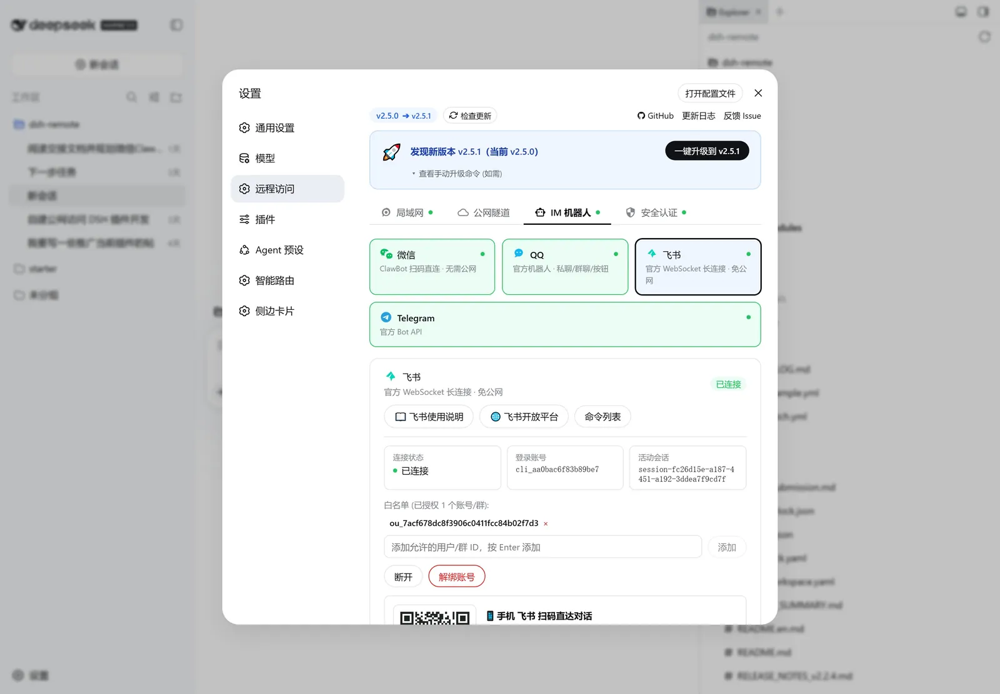
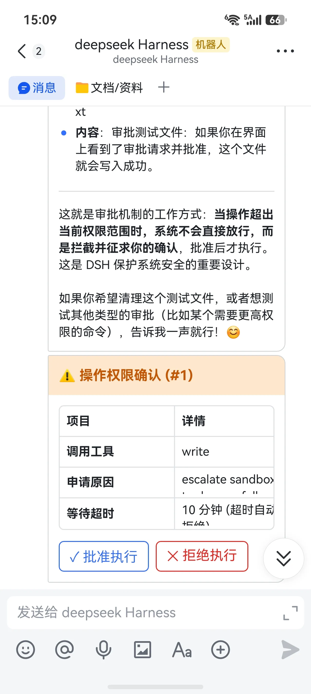

# 飞书 (Feishu / Lark) 机器人接入指南

> 通过飞书官方开放平台 **WebSocket 长连接（免公网 IP）** 模式，将本地 DeepSeek Harness 接入飞书，支持单聊、群聊、表格命令与原生交互卡片权限审批。
>
> **本版（v2.14.0）起**：底层已**全面替换为飞书官方 Channel SDK**；接入推荐走 **方式一：手机扫码一键创建应用**（权限、事件订阅、卡片回调自动预置，无需进开发者后台）。另新增原生**斜杠指令面板**、**云文档评论 @机器人**，审批卡片**决议后原地更新**。

---

## 🌟 核心优势

- **一键扫码创建应用**：接入飞书官方「一键创建智能体应用」能力，扫码即自动创建应用并预置权限、事件订阅与卡片回调，无需进开发者后台手工配置。
- **100% 免公网 IP**：基于飞书官方最新 WebSocket 长连接协议，无需配置公网服务器、无需域名、无需内网穿透工具。
- **免验签与加密配置**：长连接由飞书官方 SDK 在建立通道时完成认证，无需开发者手动处理 HTTP 回调验签。
- **飞书原生交互卡片**：Agent 触发敏感工具审批时，飞书端下发带点击按钮的交互卡片，手机/电脑端单手一键点击即可完成批准或拒绝。
- **多工作区与会话持久化**：支持 `/sessions` 表格查看历史会话、`/use <序号>` 极速切换、`/workspaces` 工作区调度。

---

## 🚀 方式一：一键扫码创建应用（推荐，无需开发者后台）

本插件已接入飞书官方 **一键创建飞书智能体应用** 能力（`registerApp`，OAuth 2.0 设备码流程）。
无需进入开发者后台手工创建应用、逐条勾选权限与事件订阅——扫码确认后自动预置全部所需配置。

1. 打开 DeepSeek Harness，进入「设置」➔「远程访问」➔「IM 机器人」➔ 选择 **「飞书」**；
2. 点击面板左上方的 **「📱 扫码一键创建应用」** 按钮，面板会出现二维码；
3. 使用手机飞书扫码，在确认页确认创建（可修改应用名称/头像），确认后插件会**自动保存凭据并连接**；
4. 状态显示为绿色 **「已连接」** 即表示长连接成功建立（如需给机器人发消息，可扫面板上的机器人二维码直达会话）。



> 二维码 10 分钟内有效且仅可使用一次。二维码在手机上看不清、或已过期时，点二维码下方的
> **「🔄 重新生成二维码」** 立即换新码（旧码随之失效）；关掉设置窗口不会中断流程，重新打开会显示
> 当前二维码，超过 10 分钟后自动提示过期、可重新生成。

自动预置的内容（飞书官方"智能体应用配置清单"）：

- **应用能力**：机器人；
- **权限**：以应用身份发消息、获取与上传图片/文件资源、读取单聊消息、读取群聊中 @ 机器人的消息、
  更新消息、创建与更新卡片（流式卡片所需）等；
- **事件订阅（长连接 / WebSocket）**：`im.message.receive_v1`（接收消息）等；
- **回调**：`card.action.trigger`（审批卡片按钮点击）。

> 群聊中机器人默认需要被 **`@`** 才会响应；单聊直接发消息即可。

---

## 🛠️ 方式二：手动创建企业自建应用（已有应用/需自定义配置时）

### 第一步：创建飞书企业自建应用

1. 登录 [飞书开放平台开发者后台](https://open.feishu.cn/app)；
2. 点击右上角 **「创建企业自建应用」**，填写应用名称（如 `DeepSeek Harness`）与应用描述，上传机器人头像；
3. 创建完成后，在左侧导航栏点击 **「凭证与基础信息」**，即可查看到：
   - **App ID**（格式如 `cli_a1b2c3d4...`）
   - **App Secret**（点击复制密钥）

---

### 🤖 第二步：添加机器人能力

1. 在应用详情页左侧导航栏，点击 **「添加应用能力」**；
2. 找到 **「机器人」**，点击 **「添加」** 开启机器人能力。

---

### 🔐 第三步：开通必要权限

在左侧导航栏点击 **「权限管理」**，搜索并开通以下权限：

| 权限名称 | 权限 Key | 权限说明 |
| :--- | :--- | :--- |
| **读取用户发给机器人的单聊消息** | `im:message.p2p_msg:readonly` | 单聊消息接收（必需） |
| **获取群组中用户@机器人消息** | `im:message.group_at_msg:readonly` | 群聊中被 `@` 时接收消息（必需） |
| **以应用的身份发消息** | `im:message:send_as_bot` | 机器人回复消息（必需） |
| **获取与上传图片或文件资源** | `im:resource` | 附件双向传输（必需） |
| **更新消息** | `im:message:update` | 消息/卡片更新（必需） |
| **创建与更新卡片** | `cardkit:card:write` | 流式打字机卡片（必需） |
| **获取卡片信息** | `cardkit:card:read` | 读取卡片实例（必需） |
| **获取机器人的基本信息** | `application:bot.basic_info:read` | 面板展示机器人名称（必需） |

> 与「方式一」相比，手动方式需要自行保证上表完整；缺权限时对应功能会失效（例如缺少 `cardkit:card:write`
> 会导致流式输出降级为普通消息）。

---

### ⚡ 第四步：开启 WebSocket 长连接事件订阅

1. 在左侧导航栏点击 **「事件与回调」**；
2. 在 **「事件配置」** 页面，将事件接收方式切换为 **「使用长连接接收事件」**（WebSocket 模式）；
3. 点击 **「添加事件」**，勾选并添加：
   - **`im.message.receive_v1`**（接收消息）
   - **`card.action.trigger`**（消息卡片回传交互 / 审批按钮点击）
4. 保存配置。

---

### 🚀 第五步：版本发布

1. 在左侧导航栏点击 **「版本管理与发布」**；
2. 点击 **「创建版本」**，填写版本号（如 `1.0.0`），设置应用可用范围（如「所有员工」或「仅自己」）；
3. 点击 **「申请发布」**（自建应用通常由企业管理员直接免审或一键通过）。

---

### 第六步：在 DSH 客户端中连接

1. 打开 DeepSeek Harness，进入「设置」➔「远程访问」➔「IM 机器人」➔ 选择 **「飞书」**；
2. 在表单中填入刚才复制的 **App ID** 和 **App Secret**；
3. 点击 **「保存并连接」**；
4. 状态显示为绿色 **「已连接」** 即表示长连接成功建立！

> 国际版 Lark 用户请把应用凭据填入后，将域名配置为 `lark`（一键创建流程会按扫码账号自动识别并写入）。

---

## 💬 常用操作与指令

在飞书与机器人单聊或在群里 `@机器人` 即可开始对话：

### 0. 指令面板（Slash Command，默认自动注册）

连接成功后插件会**自动把下列指令注册到飞书输入框的 `/` 指令面板**（幂等，不需要手工配置）：

| 指令 | 用途 |
| :--- | :--- |
| `/help` | 查看可用指令与用法 |
| `/new` | 新建会话并开始任务（可跟提示词） |
| `/sessions` | 列出历史会话 |
| `/use` | 切换到指定编号的会话 |
| `/rename` | 重命名当前会话 |
| `/workspaces` | 查看已注册工作区 |
| `/addworkspace` | 添加工作区目录 |
| `/status` | 查看 Agent 运行状态 |
| `/stop` | 停止当前正在执行的任务 |
| `/end` | 结束当前会话 |
| `/diff` | 导出本轮改动的 `.patch` 补丁附件 |
| `/ask` | 回答 Agent 的提问：`/ask 1` 选选项、`/ask 1,3` 多选、`/ask =自由输入`、`/ask 1; 2=1` 多问分别作答；裸 `/ask` 重新查看当前问题 |

其中 `/diff` 与「本轮改动摘要」都基于 DSH 宿主记录的**每轮改动清单**（与 Web 端"改动"面板同源）：每轮结束会在会话里播报`本轮改动 N 个文件（+增/-删）`，无改动则保持安静；不想收到可在设置页关闭「本轮改动摘要」开关。

**关于 Agent 提问**：Agent 需要你做个决定时会主动发到会话（例如「用哪种方案？」）。单问单选时会给**选项卡片**——每行一个按钮、推荐项带 ⭐ 高亮，点一下即作答；多问、多选或需要自由输入时改为文字提示，按上面 `/ask` 的写法回复即可。这类提问**只在飞书发起的轮次里接管**，Web 端弹出的提问不会被抢走；若一时没回，超时后仍可用 `/ask` 补答。

**关于「正在做什么」的活动状态**：Agent 干活时，回复卡片顶部会实时显示它当前的动作，让你知道任务没有卡住（与 Web 端「思考 / 运行命令」是同一套口径）：

```
> _⌨️ 正在运行命令（npm test） · 第 3 轮_

（Agent 的回复正文，随进展持续累积）
```

- 状态行用**引用块 + 斜体**呈现，与正文一眼区分（引用块后自动空行分隔）；
- **从第一个动作就可见**：Agent 一开始干活（首次工具调用）就建卡显示状态，不必等第一段正文（早先要等首块文本，可能隔几十秒才有，期间看不到任何进展）；
- 覆盖：分析请求 / 读取文件 / 读取图片 / 写入文件 / 编辑文件 / 搜索代码 / **运行命令** / 运行代码 / 搜索网页 / 访问网页 / **协调子智能体** / 更新计划 / 等待你的操作；
- **不刷屏**：卡片原地更新、不产生新消息；同一状态不重复推送，1 秒内的连续变化会合并，且**窗口结束时一定补发最新状态**（不会把中间状态丢掉）；
- **轮次结束自动消失**，最终卡片只留正文，不留过程痕迹；
- **默认关闭**：设置页勾选「实时活动状态」才会显示（默认不显示，只保留正文）；
- 刷新频率可用 `activityIntervalSec` 调整（单位秒；`0` = 每次变化都推，底层仍受飞书 SDK 100ms 限流保护）。

要点与排查：

- **客户端版本要求**：PC 端飞书 **≥ 7.70**、移动端 **≥ 7.71** 才会显示指令面板；低版本仍可直接手打 `/help` 等指令（功能完全一致）。
- **生效延迟**：注册后服务端同步约 5 分钟 + 客户端缓存约 3 分钟，最长约 8 分钟后才在 `/` 面板出现；可重启飞书客户端加速。
- **看不到指令时**：确认应用已开通 `application:app_slash_command:read` 与 `application:app_slash_command:write` 权限并**已发布版本**（一键扫码创建的应用默认已含），然后在设置面板点一次 **「重新连接」** 即可重新同步。
- 插件只会更新/清理**自己注册的**指令（记录 `command_id`），不会影响你手工创建的其他指令。

### 1. 会话与工作区管理
| 指令 | 说明 | 示例 |
| :--- | :--- | :--- |
| `/sessions` | 查看所有历史会话表格 | `/sessions` 或 `/list` |
| `/use <编号>` | 切换到指定编号会话 | `/use 1` 或 `/resume 1` |
| `/new <提示词>` | 在当前工作区创建新会话并开始 | `/new 帮我写个脚本` |
| `/new <词> @N` | 在指定工作区新建会话 | `/new 帮我写个脚本 @1` |
| `/rename <新标题>` | 重命名当前活动会话 | `/rename 优化登录交互` |
| `/workspaces` | 查看所有已注册的工作区列表 | `/workspaces` |
| `/addworkspace <路径>` | 注册添加新的电脑工作区目录 | `/addworkspace D:\projects\app` |
| `/status` | 查看 Agent 运行状态看板 | `/status` |
| `/diff` | 把本轮改动的文件导出为 `.patch` 补丁附件 | `/diff` |
| `/stop` | 中断停止当前正在执行的任务 | `/stop` |
| `/end` | 结束当前会话回到空闲状态 | `/end` |

### 2. 云文档评论里 @机器人

在飞书**云文档（文档/表格）评论**中 `@机器人` 提问，插件会把评论内容（含行内评论**选中的原文**）交给 agent，并把回答**回复在该评论线程里**：

- 同一评论线程里**后续追问不必再 @**；其他未 @ 的评论不会被处理；
- 评论只能用**纯文本**交互：回答在**一轮结束时一次性发出**（没有打字机流式）、不支持卡片按钮与文件发送；
- 若这轮需要**工具审批**，审批会回到电脑端/远程面板处理（评论里没有可点的卡片）；
- 一键扫码创建的应用**已自带**所需权限与事件；手工创建的应用需在开放平台开通文档评论权限与 **`drive.notice.comment_add_v1`** 事件并发布版本。

### 3. 话题群与引用回复

- **话题群**：在话题里 `@机器人` 提问，机器人的回复会**留在同一个话题内**（不会掉到群主流）；
- **引用回复**：引用某条消息再提问时，插件会自动把**被引用那条消息的正文**一并发给 agent 作为上下文（截断 600 字），所以可以直接说"这个改成…"而不必重复背景。

### 4. 权限审批交互
当 Agent 尝试执行需授权的操作（如终端命令、写敏感文件）时，飞书端会自动推送 **原生交互卡片**：
- 点击卡片上的 **「✓ 批准执行」** 或 **「✕ 拒绝执行」** 按钮即可一键处理；
- 决议后**卡片原地更新为结果态**：表头变绿/红/灰，新增「决议结果」行（含决议者昵称），按钮消失——不会再收到一条重复的"已批准/已拒绝"文字消息；
- 卡片还会显示 **「发起人」**（群聊里发起审批的成员昵称）；
- 超时（默认 10 分钟）会自动拒绝并把卡片标成 **⏰ 已超时**；任务被中止则标成 **⚪ 已取消**；
- 亦可直接回复文字 `/yes` (或 `1`) / `/no` (或 `2`)。



---

## ❓ 常见问题 (FAQ)

### Q1: 点击卡片上的「批准」/「拒绝」按钮提示无权限或无反应？
若使用「方式一：一键扫码创建」，权限与事件已由官方模板预置，请先点击面板上的 **「重新连接」**；
仍无效时再按下列手工配置项核对：
1. **是否订阅了卡片交互事件**：在开放平台后台 **「事件与回调」➔「事件配置」** 中，必须添加 **`card.action.trigger`**（消息卡片回传交互）事件。若只添加了接收消息事件，卡片点击不会下发回调。
2. **是否发布了新版本生效**：飞书平台的所有权限与事件变更，**必须在「版本管理与发布」中「创建版本」并申请发布通过后才会生效**。
3. **应用可用范围**：在「版本管理与发布」中，确认应用可用范围包含了您当前的飞书账号（建议设为「所有员工」或将自己加入可用成员）。
4. **快速应急处理**：如果卡片按钮暂时受网络或配置影响，可直接在聊天中回复文字 **`/yes`**（或 `1`）批准，回复 **`/no`**（或 `2`）拒绝。

### Q2: 机器人无法在群聊中回复消息？
1. 群聊中必须 **`@机器人`** 才会响应（本插件按官方默认策略要求 @，避免在群里刷屏）；
2. 确保在「权限管理」中开通 **`im:message.group_at_msg:readonly`**（获取群组中用户@机器人消息）；
3. 确保在「版本管理与发布」中发布了包含该权限的新版本；
4. 若希望新群首次 `@机器人` 即自动加入白名单，可在设置页打开「群聊自动授权」开关。

### Q3: 鸿蒙版飞书里 `/help`、`/sessions` 的表格显示不全（只剩标题）？

已知**鸿蒙版飞书不渲染消息内的 Markdown 表格**（同一会话在 **iOS 版 / PC 版**飞书显示正常），属客户端渲染差异。插件已按飞书官方 `md` 规范补齐表格空行分隔，但鸿蒙端仍可能不渲染表格内容。

- **已适配**：含表格的回复（`/help`、`/sessions`、`/workspaces`、`/status`）已自动改走**交互卡片**渲染（另一套渲染器，与旧版本观感一致）；无表格的回复仍是富文本消息。若鸿蒙端仍不显示表格内容，请告知我们，可用 `/new`、`/stop`、`/end` 等非表格指令，或改在 **iOS 版 / PC 版**飞书查看会话与工作区列表。
